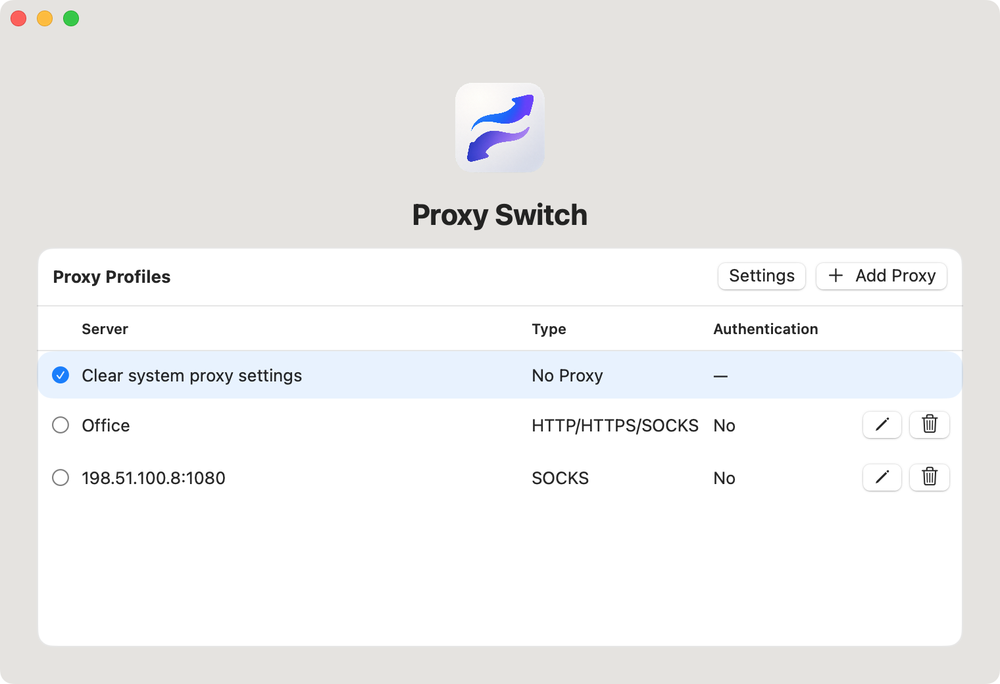

<p align="center">
  
</p>

<h1 align="center">Proxy Switch for macOS</h1>

Proxy Switch changes your Mac’s system proxy from the main window or menu bar. Save frequently used servers as profiles and switch between them with a click.



*Captured on macOS 15 with example profiles.*

## Features

- Named profiles for HTTP, HTTPS, and SOCKS, with optional authentication.
- A **No Proxy** action that turns off manual proxy settings, automatic configuration, and proxy discovery for the active network service.
- A menu bar icon that reflects the system proxy status and lets you switch profiles.
- Finder-style sidebar material, with Liquid Glass on macOS 26.
- Light, Dark, and Follow System appearances, plus 13 interface languages. Language changes apply when confirmed.
- Optional launch at login and start minimized.

## Install

Choose the **Intel (x86_64)** or **Apple Silicon (arm64)** DMG from the repository’s GitHub Releases page. Open it and drag **Proxy Switch** into **Applications**. The app requires macOS 13 or later. macOS may request permission when proxy settings change.

## Build from source

Use Xcode with the macOS 26 SDK. From the repository root:

```bash
./native/macos/build.sh
./native/macos/package.sh
```

The build produces separate Intel and Apple Silicon apps in `build/native/macos/`. The packaging script uses Finder to lay out the DMG and writes both images to `dist/`. Pass `x86_64` or `arm64` to either script to select a single architecture.

The default build uses ad hoc signing. Public distribution requires Developer ID signing and notarization.
